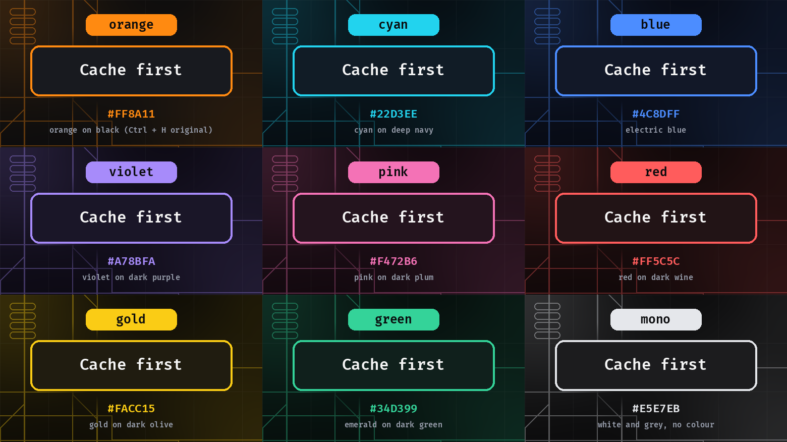
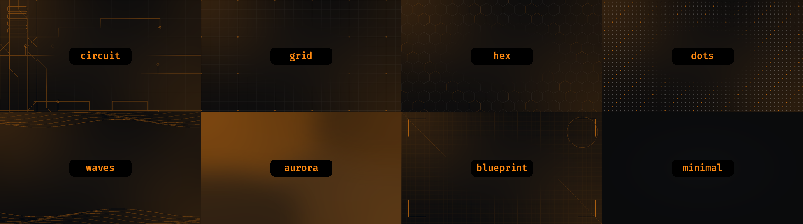
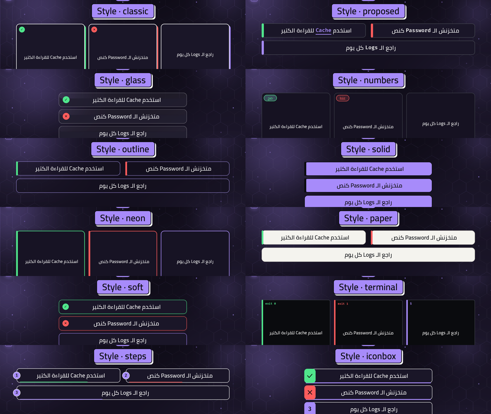
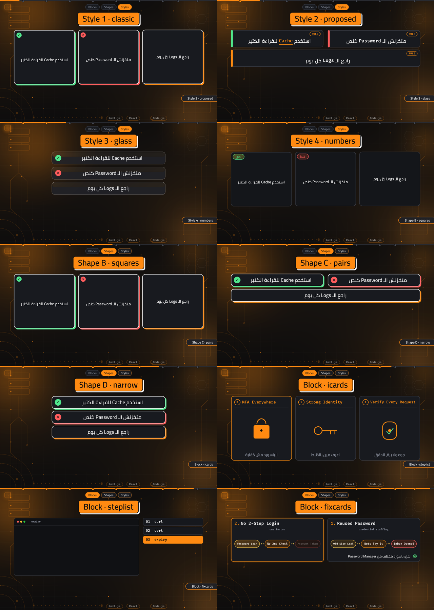
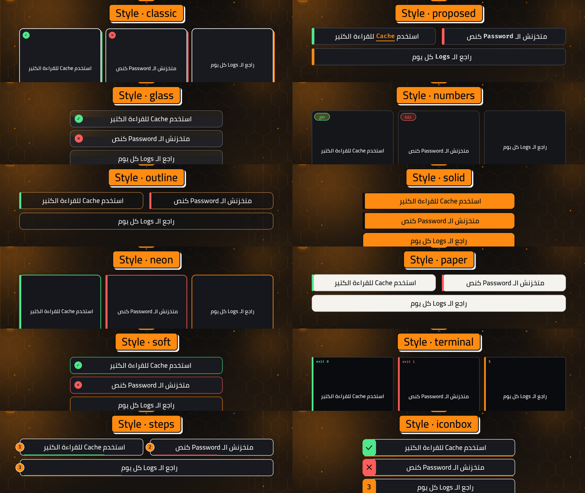
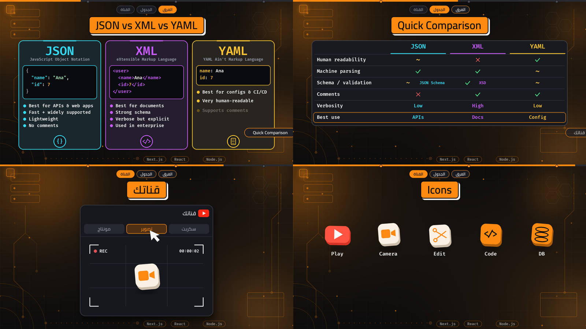

# Ctrl + H Video Kit · V2

Branded explainer-video pipeline + Claude skills, built for the **Ctrl + H** programming channel and now **usable for any channel**: on first use Claude asks for your identity, colours, card styles and background and saves them in `ctrlh.config.json`.

Takes a voiceover WAV and a declarative scene file and renders a synced **16:9 (1920x1080)** and native **9:16 (1080x1920)** video at 30 fps, with generated sound effects. No captions, no opening card.

Owner: Hesham Adel · GitHub: [@heshamadel1](https://github.com/heshamadel1)

Platforms: YouTube (`ctrlh-dev`), TikTok, Instagram, Facebook.

Content: Programming, Software Engineering, Back-End Development.

---

## What is new in V2

|               | V1                    | V2                                                                                                                                  |
| ------------- | --------------------- | ----------------------------------------------------------------------------------------------------------------------------------- |
| Who it is for | the Ctrl + H channel  | **anyone**                                                                                                                          |
| First use     | edit files by hand    | **Claude asks you** (name, colours, cards, background, logo) and saves `ctrlh.config.json`                                          |
| Colours       | orange + black        | **9 themes** (orange, cyan, blue, violet, pink, red, gold, green, mono) or your own `#RRGGBB`                                       |
| Card styles   | 4                     | **12**: classic, proposed, glass, numbers + outline, solid, neon, paper, soft, terminal, steps, iconbox; choose one, several or all |
| Backgrounds   | 1 image per tech      | **8 styles for any colour**: circuit, grid, hex, dots, waves, aurora, blueprint, minimal (or your own image)                        |
| Blocks        | cards + 3 infographic | + `versus`, `matrix`, `tabcard`, `icon3d`                                                                                           |
| Default       | all cards             | **one style (`classic`)** until you choose                                                                                          |

Pictures: `docs/images/themes.png`, `docs/images/backgrounds.png`, `docs/images/cards-12-styles-orange.png`, `docs/images/cards-12-styles-violet.png`.





### First run (what happens)

1. Install the skills (section 6) and open Claude inside this folder.
2. Ask for your first video. Claude sees there is no `ctrlh.config.json` and asks: **identity** (name, handle, platforms, language, topics), **colours** (theme or custom hex), **card styles** (one, several or all), **background**, **logo/monogram/fonts/end-card lines**. It shows the preview pictures first.
3. Claude saves the answers (`python3 engine/ctrlh_setup.py ...`), renders a short preview so you can see it, and only then builds your video.
4. Later changes: just say `use only glass and neon cards`, `switch to the cyan theme`, `background hex`, `re-run setup`.

No Claude? Run `python3 engine/ctrlh_setup.py` and answer the questions in the terminal, or copy `profiles/ctrlh.config.json` and edit it. The config keys are listed in the skill and in `engine/ctrlh_config.py`; any `CTRLH_*` environment variable still overrides the config for one command.

Preview sheets can be re-made with `python3 engine/ctrlh_preview.py docs/images`.

---

## 1. How it works (the big picture)

```
post / topic ──► voiceover script ──► voiceover WAV ──► timings ──► scene file ──► video + SFX ──► final .mp4 (+ thumbnail)
 (you / Claude)   (you / Claude)     (Google AI Studio)  (align_vo,    (SC list)    (anim.py,        (ffmpeg mux)
                                                          run_asr)                    make_audio.py)
```

Everything on screen is **declared** in one Python scene file (`SC`): which card appears at which second, which code is typed, which poll, etc. The same scene file renders both formats (`FMT=wide` and `FMT=reel`).

## 2. What is inside

| Path                                     | What it is                                                                                                                                                                            |
| ---------------------------------------- | ------------------------------------------------------------------------------------------------------------------------------------------------------------------------------------- |
| `skills/ctrlh-video-style/SKILL.md`      | Claude skill: the full video style, content workflow, voice settings, scene rules and production settings. Claude reads it to build videos the same way every time                    |
| `skills/ctrlh-thumbnail-style/SKILL.md`  | Claude skill: YouTube thumbnail style (1280x720)                                                                                                                                      |
| `engine/anim.py`                         | The scene engine: cards (4 styles), code, terminal, flow, poll, buttons, camera zoom, end card...                                                                                     |
| `engine/make_audio.py`                   | Generates sound effects (SFX) from the scene file                                                                                                                                     |
| `engine/align_vo.py`                     | Splits a voiceover into spoken phrases by silence and writes `<name>_segs.txt`                                                                                                        |
| `engine/asr_seg.py`, `engine/run_asr.sh` | Local Whisper (sherpa-onnx) transcription of each phrase                                                                                                                              |
| `engine/ctrlh_bg.py`                     | Per-technology background generator                                                                                                                                                   |
| `engine/clip.py`                         | Renders a short test clip from a scene file                                                                                                                                           |
| `engine/mix2.txt`                        | FFmpeg audio mix (voice + SFX with ducking)                                                                                                                                           |
| `examples/`                              | Real scene files to copy: `lk_scenes.py` / `nx3_scenes.py` (full videos), `v3_*`, `v4_*`, `w_scenes.py`, `v6_blocks_scenes.py` (block demos; `v6` shows the three infographic blocks) |
| `assets/fonts/`                          | Cairo SemiBold (Arabic) + Fira Code SemiBold (English/code), both SIL OFL                                                                                                             |
| `assets/backgrounds/default.png`         | Default background. Put your logo files in `assets/` too                                                                                                                              |
| `SETTINGS.md`                            | Short list of the fixed rules (platforms, voice, buttons, cards)                                                                                                                      |

## 3. Install

**Required** (video + sound effects):

| Requirement                | Notes                                                                                                |
| -------------------------- | ---------------------------------------------------------------------------------------------------- |
| Python 3.13                | the version the engine was developed and tested on (3.11 and 3.12 were only syntax-checked, not run) |
| Pillow with RAQM (libraqm) | needed for correct Arabic shaping and RTL                                                            |
| NumPy                      |                                                                                                      |
| FFmpeg                     | must be on your `PATH`                                                                               |

```bash
git clone https://github.com/heshamadel1/ctrl-h.git
cd ctrl-h
pip install pillow numpy
ffmpeg -version
```

**Optional** (only for the transcription step, section 5.1 - 5.5):

| Requirement                              | Notes                                                                       |
| ---------------------------------------- | --------------------------------------------------------------------------- |
| `onnxruntime`                            | runs the Whisper model                                                      |
| `scipy`                                  | audio resampling / spectrogram                                              |
| Whisper-small model from **sherpa-onnx** | model files only: the `sherpa-onnx` Python package itself is **not** needed |

```bash
pip install onnxruntime scipy

# Whisper-small model (about 640 MB download), placed in a folder of your choice, e.g. ~/sherpa
mkdir -p ~/sherpa && cd ~/sherpa
curl -LO https://github.com/k2-fsa/sherpa-onnx/releases/download/asr-models/sherpa-onnx-whisper-small.tar.bz2
tar xjf sherpa-onnx-whisper-small.tar.bz2
ls sherpa-onnx-whisper-small     # must contain small-encoder.int8.onnx, small-decoder.int8.onnx, small-tokens.txt
```

You can skip the transcription step: it only gives you the text of each spoken phrase so your script can be matched to the timings. The silence-based timings from `align_vo.py` work without it.

## 4. Quick start

Run everything from inside `examples/`. The commands use `lk_anim.py` / `lk_scenes.py` (both are in the repo); replace them with your own scene files for your videos.

**0. Your look (once).** Run `python3 ../engine/ctrlh_setup.py` (or just ask Claude: it asks you the same questions) to save your channel name, colours, card styles and background in `ctrlh.config.json`. Skip it to use the defaults (orange theme, `classic` cards, circuit background).

**A. Silent preview: no voiceover needed**

```bash
cd examples

FMT=wide python3 lk_anim.py frames out 20 60      # PNG frames at 20 s and 60 s (fast, do this first)
FMT=reel python3 lk_anim.py frames out_reel 20 60 # the same frames in 9:16
FMT=wide python3 lk_anim.py video v_wide.mp4      # full 16:9 render, silent (6-10 min, run in the background)
FMT=reel python3 lk_anim.py video v_reel.mp4      # native 9:16, silent
```

Always check the frames in both formats before a full render. These files have **no sound**: they are previews.

**B. Final export: needs your own voiceover WAV (`voice.wav`)**

The final video is always as long as the voiceover, and its scene file must be timed to that voiceover (section 5). The example scene files were timed to the owner's own voiceovers, which are not included, so you cannot export a finished example video without your own audio and scene file.

```bash
# 1. sound effects generated from your scene file
python3 ../engine/make_audio.py lk_scenes.py sfx.wav

# 2. the exact length of your voiceover, in seconds (copy-paste as is)
DUR=$(ffprobe -v error -show_entries format=duration -of csv=p=0 voice.wav)
echo "voiceover length: $DUR s"

# 3. mix voice + effects and cut the video to the voiceover length
ffmpeg -y -i v_wide.mp4 -i voice.wav -i sfx.wav \
  -filter_complex_script ../engine/mix2.txt \
  -map 0:v -map "[a]" -c:v copy -c:a aac -b:a 192k \
  -t "$DUR" final.mp4
```

Do the same with `v_reel.mp4` for the 9:16 version (`-t "$DUR"` stays the same). The scene file's `DUR` should equal `$DUR` (rounded), otherwise the end card will not land on your last words.

## 5. New video workflow

1. Create or edit the content for the Ctrl + H channel.
2. Prepare a ready-to-record voiceover script in Egyptian Arabic, divided into numbered scenes with approximate timestamps.
3. Generate the voiceover using Google AI Studio — Gemini Flash TTS (settings below).
4. Preferred voice settings:
   - Voice: Male
   - Script mode: Full Script
   - Language: Egyptian Arabic
   - Model version: **3.8** is the owner's own designation. Before you rely on it, open Google AI Studio and check the exact official model name / ID shown there, and use that exact name. Do not guess or rename it.
   - Preferred output: WAV
   - Temperature: Start at 0.8, or use 0.7–0.8 if the setting is available.
5. Segment the voiceover (5.1 - 5.5 below).
6. Copy a suitable scene example and its animation file (for example `lk_scenes.py` + `lk_anim.py` to `mytopic_scenes.py` + `mytopic_anim.py`, and change the import line in the anim file). Set `SC`, `STAGES`, `DUR`, `T_END`, `TAG1`, `TAG2`, and `TECH`.
7. Check frames in both formats.
8. Render the wide and native vertical versions.
9. Generate sound effects and synchronize the final audio.
10. Export and verify both videos.

### 5.1 - 5.5 Creating the timings (voice → scene times)

Name your files `<name>_vo.wav` (voiceover) and run everything from the folder where the WAV is (call it the work folder).

1. **Find the spoken phrases (no extra install):**

   ```bash
   python3 <repo>/engine/align_vo.py mytopic_vo.wav mytopic
   ```

   It cuts the WAV at silences (threshold -42 dB, gaps shorter than 0.14 s are merged, phrases shorter than 0.12 s are dropped) and writes `mytopic_segs.txt`:

   ```
   mytopic 124.76 41
   0.00-2.31, 2.80-5.12, 5.60-9.01, ...
   ```

   First line: `name  total-seconds  number-of-phrases`. Second line: `start-end` of every phrase in seconds. These start times are when your cards/code/poll should appear.

2. **Get the text of each phrase (optional, needs the model from section 3):**

   ```bash
   SHERPA=~/sherpa WORK=$PWD bash <repo>/engine/run_asr.sh mytopic
   ```

   `SHERPA` is the folder that contains `sherpa-onnx-whisper-small/`; `WORK` is the folder with `mytopic_vo.wav` and `mytopic_segs.txt`. It writes `mytopic_seg_asr.txt`:

   ```
   #1 0.00-2.31: آخر تذكرة في الحفلة
   #2 2.80-5.12: ...
   ```

   Takes about 3 minutes per 2 minutes of audio. The text is only for matching order and wording; the Whisper output can have mistakes, so trust your own script for the words.

3. **Map your script to the phrases:** go through your script line by line, in order, and give every line the start time of its phrase (about 7 syllables per second helps you spot a phrase that was split in two or merged). Put these times in the scene file (`t=`, `t0=`, `t1=`). Cards can be off by about 0.5 s when a phrase split is a guess: check frames and adjust.
4. **Set the end-card times:** the last three phrases are normally "Ctrl H", "Think Deeper", "Build Smarter". Use the start of the first one for `T_END`, then `TAG1` and `TAG2` for the other two, and the full audio length for `DUR`.
5. **Tune if needed:** if too many/few phrases are found, edit `thr` and `gap` in `segments()` inside `engine/align_vo.py`.

### The scene file in one minute

```python
DUR, T_END, TAG1, TAG2 = 124.76, 121.19, 122.49, 123.61   # audio length, end-card start, "Think Deeper" start, "Build Smarter" start
STAGES = ["Story", "Pessimistic", "Optimistic", "Summary"]  # top tabs (3-6 names)
TECH   = ["Laravel", "PostgreSQL", "MySQL"]                  # chips at the bottom
SC = [
  dict(style="classic", t0=0, t1=18.4, stage=0, head="Headline", head_t=0.2, blocks=[
      {"k": "shock", "t": 0.2, "lines": [("Big hook", 64, (255, 92, 92))]},
      c(3.5, "A card that appears at second 3.5"),
  ]),
  # ... one dict per scene
]
```

Each scene has a card `style` (`classic`, `proposed`, `glass`, `numbers`, `outline`, `solid`, `neon`, `paper`; only the styles you allowed are used), a time window (`t0`, `t1`), a `stage` index and a headline. The `blocks` are what appears, each at its own time `t`. Common blocks: `card`, `chip`, `code` (typed lines, `focus`, `shake`), `flow`, `compare`, `counter`, `poll`, `predict`, `mystery`, `strike`, `ba` (before/after), `gain`, `note`, `shock`, `promise`, `challenge`, `chips`, `tiles`, and the three "infographic" blocks `icards`, `steplist`, `fixcards` (below). See `examples/` for each one in use. The Subscribe (0:45) and Follow (40 s before the end) buttons and the end card are added automatically.

### Infographic blocks: `icards`, `steplist`, `fixcards`

Three blocks for list-style topics. All times are seconds in the voiceover; every item appears at its own `t`; the item being spoken is highlighted. In 16:9 the first item is placed on the right (Arabic reading order; pass `"rtl": False` for left-to-right). Demo: `examples/v6_blocks_scenes.py` (`FMT=wide python3 v6_blocks_anim.py frames out 13.5 19 36`).

**`icards`: numbered cards with an animated icon and a one-line caption** (e.g. "Zero Trust" principles)

```python
{"k": "icards", "t": 0.4, "cols": 3, "cols_reel": 2, "items": [
  {"t": 1.0, "title": "Verify Every Request", "icon": "shield", "caption": "جوه ولا برة، اتحقق"},
  {"t": 4.0, "title": "Strong Identity",      "icon": "grid",   "caption": "اعرف مين بالظبط"},
]}
```

Icons: `shield`, `grid`, `bar`, `clock`, `lock`, `nodes`, `key`, `warn`, `check`, `db`, `bolt` (anything else gives a plain circle). Use 3-6 items; the title is shrunk to fit the card.

**`steplist`: step list + terminal that shows the current step's commands** (e.g. "10 commands to check HTTPS")

```python
{"k": "steplist", "t": 14.4, "list_side": "right", "items": [
  {"name": "expiry", "t": 20.0, "file": "when it expires", "lines": [
      (0.0, "$ openssl x509 -in cert.pem -noout -enddate", 40),     # (seconds after item t, text, chars per second[, kind])
      (2.0, "notAfter=Oct 27 23:59:59 2026 GMT", 40, "bad")]},       # kind: cmd | out | ok (green) | bad (red band)
  {"name": "issuer", "t": 23.0},
]}
```

The current step is orange, finished steps are white, the rest dim. A line starting with `$` is a command. Items without `lines` just advance the list. Up to about 10 items.

**`fixcards`: problem → 3-step chain → fix** (e.g. "email mistakes and fixes")

```python
{"k": "fixcards", "t": 28.4, "cols": 2, "cols_reel": 1, "items": [
  {"t": 28.8, "title": "Reused Password", "sub": "credential stuffing",
   "chain": ["Old Site Leak", "Bots Try It", "Inbox Opened"],       # appear one by one (or give "chain_t": [..])
   "fix": "الحل: باسورد مختلف من Password Manager",                 # appears after the chain (or give "fix_t")
  },
]}
```

The chain is colored amber → orange → red. Put the Latin words of the fix line at the end of the sentence to keep the right-to-left order clean. The active card glows. 2-4 items fit best (up to 6 with `cols: 3`). Sound effects for all three blocks are generated automatically by `make_audio.py`.

## 6. Using the skills with Claude

### Install

Copy the two folders inside `skills/` into your Claude skills directory:

`~/.claude/skills/`

(so you get `~/.claude/skills/ctrlh-video-style/SKILL.md` and `~/.claude/skills/ctrlh-thumbnail-style/SKILL.md`). Restart Claude Code. In other Claude apps that support skills, upload the folders as skills.

The skills cover the Ctrl + H video style, content creation, voiceover preparation, thumbnails, and production workflow.

### Use

Open Claude **inside this repo folder** (so it can run `engine/` and see `examples/` and `assets/`) and just ask in plain words. Claude loads the skill by itself when you mention a Ctrl + H video. Examples you can copy:

- `Write a post and a voiceover script about Laravel queues for the Ctrl + H channel.`
- `Here is my voiceover WAV for the queues video (queues_vo.wav) and the script. Build the video in 16:9 and 9:16 and a thumbnail.`
- `Only check frames at 10, 40 and 90 seconds, do not render the full video yet.`
- `Do not render any video, only update the engine / skill.`

Claude will follow the skill: segment the voice, map the script to the timings, write the scene file, check frames, render both formats, generate SFX, mux, and send the final files.

> The skill files describe the original channel (the owner's name, Egyptian Arabic replies, the Ctrl + H sign-off). If you use the kit for **your own** channel, open both `SKILL.md` files and change those lines first (see section 8).

## 7. Change colors, fonts and video size

### Priority: who wins when settings disagree

1. **Environment variables** typed in front of a command (`CTRLH_ACCENT=#00B8D9 python3 ...`): win, but only for that one command.
2. **`ctrlh.config.json`**: your saved settings, used for every video of this channel.
3. **Defaults** built into the engine (orange theme, `classic` cards, circuit background).

The saved config belongs to the **current channel** (the folder it lives in). Another channel = another folder with its own `ctrlh.config.json` (or point to it with `CTRLH_CONFIG=/path/ctrlh.config.json`).

You can change the config at any time **without editing the skills**: say it to Claude ("use only glass and neon cards", "switch to the cyan theme", "background hex"), run `python3 engine/ctrlh_setup.py` again, or edit `ctrlh.config.json` by hand. The skill files stay the same.

These are the environment variables (no code editing). Put them in front of any command:

| What                                                                           | Variable            | Example                                               |
| ------------------------------------------------------------------------------ | ------------------- | ----------------------------------------------------- |
| Colour theme (orange, cyan, blue, violet, pink, red, gold, green, mono)        | `CTRLH_THEME`       | `CTRLH_THEME=violet`                                  |
| Accent color (default orange `#FF8A11`)                                        | `CTRLH_ACCENT`      | `CTRLH_ACCENT=#00B8D9`                                |
| Background style (circuit, grid, hex, dots, waves, aurora, blueprint, minimal) | `CTRLH_BG_STYLE`    | `CTRLH_BG_STYLE=hex`                                  |
| Background base colour                                                         | `CTRLH_BG_COLOR`    | `CTRLH_BG_COLOR=#0A0F1E`                              |
| Card styles used in the video (default: `classic` only)                        | `CTRLH_CARD_STYLES` | `CTRLH_CARD_STYLES=glass`, `classic,numbers` or `all` |
| Card background color                                                          | `CTRLH_CARD_COLOR`  | `CTRLH_CARD_COLOR=#1B2A41`                            |
| Arabic font file                                                               | `CTRLH_FONT_AR`     | `CTRLH_FONT_AR=/path/Tajawal-Bold.ttf`                |
| English / code font file                                                       | `CTRLH_FONT_LATIN`  | `CTRLH_FONT_LATIN=/path/JetBrainsMono-Bold.ttf`       |
| Output width (height follows the aspect ratio)                                 | `OUT_W`             | `OUT_W=1280` gives 1280x720 (16:9) or 720x1280 (9:16) |
| Background image                                                               | `BGFILE`            | `BGFILE=assets/backgrounds/bg_react.png`              |
| Assets folder (fonts, logo, monogram)                                          | `CTRLH_ASSETS`      | `CTRLH_ASSETS=/my/assets`                             |
| Subscribe / Follow time (seconds)                                              | `SUB_T`, `FOL_T`    | `SUB_T=30 FOL_T=100`                                  |

Examples:

```bash
# cyan brand + 1280x720 output
CTRLH_ACCENT=#00B8D9 OUT_W=1280 FMT=wide python3 lk_anim.py video v720.mp4

# 4K output
OUT_W=3840 FMT=wide python3 lk_anim.py video v4k.mp4

# a background in the same accent color
CTRLH_ACCENT=#00B8D9 python3 ../engine/ctrlh_bg.py react ../assets/backgrounds/bg_cyan.png ../assets/fonts/FiraCode-SemiBold.ttf
CTRLH_ACCENT=#00B8D9 BGFILE=../assets/backgrounds/bg_cyan.png FMT=wide python3 lk_anim.py video v.mp4
```

### Everything the engine can draw (with pictures)

All pictures are in `docs/images/` (16:9 and 9:16 versions, plus `overview-16x9.png` and `overview-9x16.png`). They are made from `examples/showcase_scenes.py`; re-make them with `CTRLH_CARD_STYLES=all FMT=wide python3 examples/showcase_anim.py frames out 5 11 17 23 29 35 41 45 50 55`.





**Count: 12 card styles + 3 card shapes (+1 legacy) + 3 infographic blocks + 4 newer blocks (`versus`, `matrix`, `tabcard`, `icon3d`).**

| #   | Card style | What it looks like                                            | Best for                         | Picture                                  |
| --- | ---------- | ------------------------------------------------------------- | -------------------------------- | ---------------------------------------- |
| 1   | `classic`  | thick border, hard colored shadow, round check/cross badge    | good / bad statements            | `docs/images/style-1-classic.png`        |
| 2   | `proposed` | status bar on the edge, small `tag` pill, key word underlined | rules and definitions            | `docs/images/style-2-proposed.png`       |
| 3   | `glass`    | translucent card, light border                                | calm explanations, closing lines | `docs/images/style-3-glass.png`          |
| 4   | `numbers`  | big faint index 01/02/03 + right/wrong pill                   | steps and mistakes lists         | `docs/images/style-4-numbers.png`        |
| 5   | `outline`  | thin outline, nearly transparent fill                         | calm lines                       | `docs/images/cards-12-styles-orange.png` |
| 6   | `solid`    | filled with the accent colour, dark text                      | one key statement                | same sheet                               |
| 7   | `neon`     | glowing accent border                                         | good / bad, emphasis             | same sheet                               |
| 8   | `paper`    | light card, dark text                                         | high contrast                    | same sheet                               |
| 9   | `soft`     | status-colour border, soft glow, round badge                  | right / wrong lists              | same sheet                               |
| 10  | `terminal` | terminal line: `exit 0` / `exit 1`, `$`                       | commands and results             | same sheet                               |
| 11  | `steps`    | numbered circle on the edge, progress underline               | ordered steps                    | same sheet                               |
| 12  | `iconbox`  | coloured block with check / cross / number                    | right / wrong lists              | same sheet                               |

| Card shape (several cards in one scene) | Layout                                         | Picture                           |
| --------------------------------------- | ---------------------------------------------- | --------------------------------- |
| `squares`                               | equal squares side by side                     | `docs/images/shape-B-squares.png` |
| `pairs`                                 | two columns                                    | `docs/images/shape-C-pairs.png`   |
| `narrow`                                | one centered column, 60% wide (`cw=0.6`)       | `docs/images/shape-D-narrow.png`  |
| long (legacy)                           | full-width stacked, only with `longcards=True` | not used                          |

| Infographic block | For                                                      | Picture                          |
| ----------------- | -------------------------------------------------------- | -------------------------------- |
| `icards`          | principles / pillars, numbered cards with animated icons | `docs/images/block-icards.png`   |
| `steplist`        | N commands, step list + terminal                         | `docs/images/block-steplist.png` |
| `fixcards`        | mistake, chain of 3 chips, fix                           | `docs/images/block-fixcards.png` |

| Newer block | For                                                                                                                                  | Picture                         |
| ----------- | ------------------------------------------------------------------------------------------------------------------------------------ | ------------------------------- |
| `versus`    | 2-3 columns, each with its OWN colour: name, code sample, bullets (e.g. JSON vs XML vs YAML)                                         | `docs/images/block-versus.png`  |
| `matrix`    | comparison table, cells `ok` / `bad` / `mid` / text / `(kind, note)`                                                                 | `docs/images/block-matrix.png`  |
| `tabcard`   | one card with tabs; a cursor presses each tab and a small scene changes inside (`play`, `rec`, `edit`, `script`, or any icon3d kind) | `docs/images/block-tabcard.png` |
| `icon3d`    | row of flat tiles with depth edge, shadow, bobbing + tilt (`play camera scissors code doc db`)                                       | `docs/images/block-icon3d.png`  |



Per-column colours in `versus`/`matrix` are written as `"#RRGGBB"`; leave `color` out to use the accent. Demo scene: `examples/v7_blocks_scenes.py` (`FMT=wide python3 examples/v7_blocks_anim.py frames out 11 22.5 30.5 38.5`). Sound effects for all four are generated by `make_audio.py`.

Shapes and blocks are chosen by the scene file (shapes rotate automatically); **card styles** are the thing you choose when you install.

### Choosing card styles, colours and background

**Default for a new install: one style, `classic`.** You (the person who installed the kit) decide: keep it, pick another one, a few of them, or use all twelve.

```bash
python3 lk_anim.py ...                                                      # default: classic only
CTRLH_CARD_STYLES=glass FMT=wide python3 lk_anim.py video v.mp4             # one style for the whole video
CTRLH_CARD_STYLES=classic,numbers FMT=wide python3 lk_anim.py video v.mp4   # only these two, rotating
CTRLH_CARD_STYLES=all FMT=wide python3 lk_anim.py video v.mp4               # all twelve, a different one per scene
CTRLH_CARD_COLOR=#1B2A41 CTRLH_ACCENT=#00B8D9 BGFILE=../assets/backgrounds/bg_cyan.png \
  FMT=wide python3 lk_anim.py video v.mp4                                    # card color + accent + video background
```

A scene that asks for a style that is not allowed uses the allowed ones in rotation. To make your choice permanent for Claude, see "What to tell Claude" below.

Notes:

- The layout is designed for **two shapes only**: 16:9 (1920x1080) and 9:16 (1080x1920). `OUT_W` rescales the finished video (sharper or smaller); it does not create other aspect ratios (1:1, 4:5 need new layout work).
- Fonts must be `.ttf` files. The Arabic font needs Arabic glyphs; the English/code font should be monospaced for the code cards.
- Colors other than the accent and card color (background charcoal, white text, card color, green/red) are constants at the top of `engine/anim.py` (`INK`, `PAPER`, `CARDC`, `GRN`, `RED`).
- Your own logo: put `logo_ch.png` (square, shown on the end card) and `mono.png` (small corner monogram) in `assets/`. Without them a neutral placeholder frame is used. The original Ctrl + H logo and brand assets must retain their original proportions and appearance.

### What to tell Claude after you install the skills

Claude saves your choices in `ctrlh.config.json` (not in the skill files), so they apply to every later video of this channel. Environment variables still win for a single command. Copy and edit:

- `Use only the glass card style with card color #1B2A41 in every video.`
- `Use all card styles in every video.`
- `Switch to the cyan theme and the hex background.`
- `Use accent color #00B8D9 for every video and regenerate the background with it.`
- `Use the fonts assets/fonts/Tajawal-Bold.ttf for Arabic and assets/fonts/JetBrainsMono-Bold.ttf for English.`
- `Render every video at 1280x720 and 720x1280.`
- `My channel is called <Name> on <platforms>, end-card lines "<line 1>" / "<line 2>". Re-run the setup.`
- `I added my logo (assets/logo_ch.png) and monogram (assets/mono.png). Check them in a frame at the end card.`

## 8. Using it for your own channel

Replace the identity everywhere it appears. Checklist:

| Where                                   | What to change                                                                                                                                                                       |
| --------------------------------------- | ------------------------------------------------------------------------------------------------------------------------------------------------------------------------------------ |
| `assets/logo_ch.png`, `assets/mono.png` | your logo (end card) and corner monogram                                                                                                                                             |
| `skills/ctrlh-video-style/SKILL.md`     | owner, channel name, platforms, language, sign-off words ("Think Deeper." / "Build Smarter."), voice settings, logo description, "Ctrl H" spoken ending                              |
| `skills/ctrlh-thumbnail-style/SKILL.md` | channel name/logo, tagline, reference image description                                                                                                                              |
| End card text                           | no code edit needed: `CTRLH_SIGNOFF_1="Your line 1." CTRLH_SIGNOFF_2="Your line 2."` (also say these words at the end of your voiceover, and set `TAG1`/`TAG2` to when you say them) |
| Chapter banner and card labels          | `CTRLH_LABEL_CHAPTER` (default `الجزء`), `CTRLH_LABEL_OK` (`صح`), `CTRLH_LABEL_WRONG` (`غلط`); for other languages also change the headline text in your scene files                 |
| `SUBSCRIBE` / `FOLLOW` button labels    | fixed English text in `engine/anim.py` (search `SUBSCRIBE`)                                                                                                                          |
| `STAGES`, `TECH`, scene text            | live in your scene file                                                                                                                                                              |
| `engine/ctrlh_bg.py`                    | background motifs per technology (and the docstring name)                                                                                                                            |
| `README.md`, `SETTINGS.md`, `LICENSE`   | name, GitHub link, platforms, copyright line                                                                                                                                         |

Search the repo for leftovers before publishing:

```bash
grep -rniE "ctrl ?\+? ?h|ctrlh|hesham|think deeper|build smarter" --include="*.py" --include="*.md" --include="*.txt" .
```

Then pick your colors and fonts (section 7).

## Troubleshooting

| Problem                                        | Fix                                                                                         |
| ---------------------------------------------- | ------------------------------------------------------------------------------------------- |
| Arabic letters look disconnected or reversed   | Pillow was built without RAQM. Install `libraqm` and reinstall Pillow                       |
| Squares (tofu) instead of Arabic text          | The English font is being used for Arabic. Set `CTRLH_FONT_AR` to a font with Arabic glyphs |
| Full render hits a time limit                  | Run it in the background (`nohup ... &`) and wait; ~3,800 frames take 6-10 min per format   |
| Video and audio lengths differ                 | Use `-t <DURATION>` in the mux command and make `DUR` equal the audio length                |
| `align_vo.py` finds too many / too few phrases | Edit `thr` (silence threshold, default -42 dB) and `gap` in `segments()`                    |

## License

- Code: MIT (see `LICENSE`; owner's decision, 2026-10-30).
- Fonts: SIL Open Font License.
- Ctrl + H name and logo: These are the channel owner's brand assets. Do not reuse them without permission.
