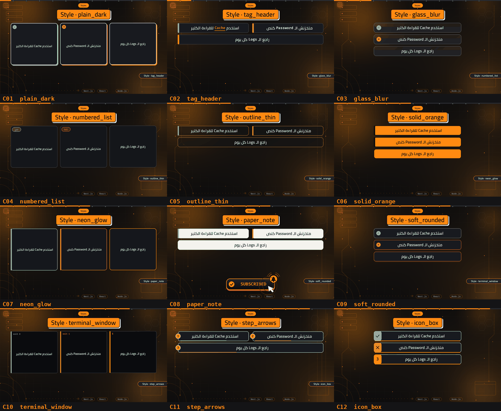
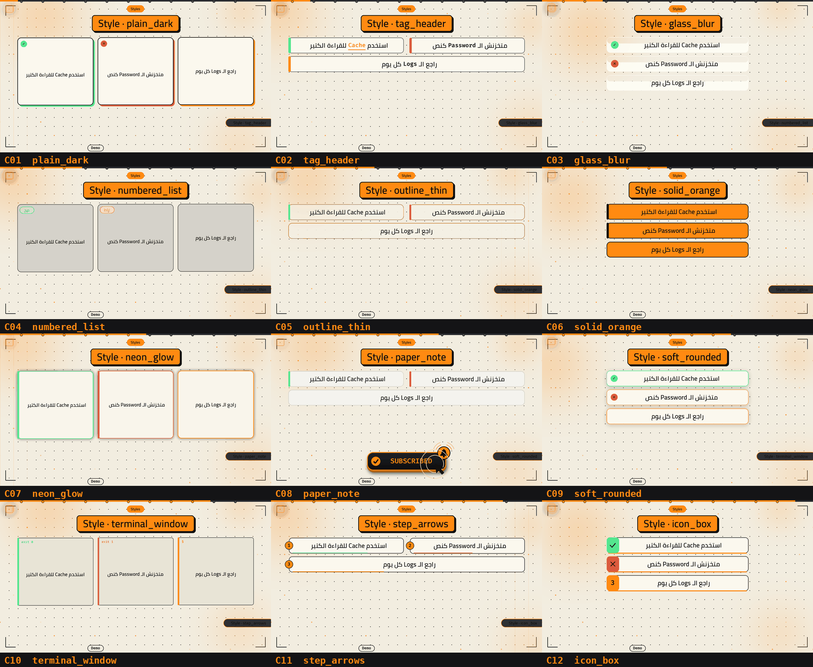
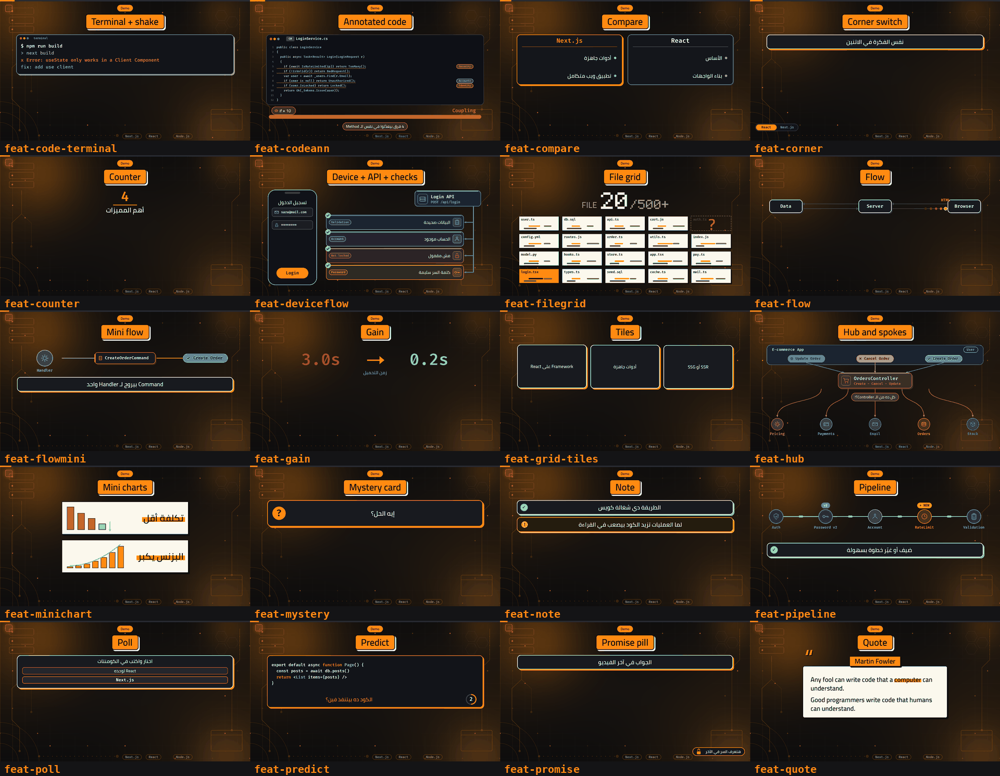
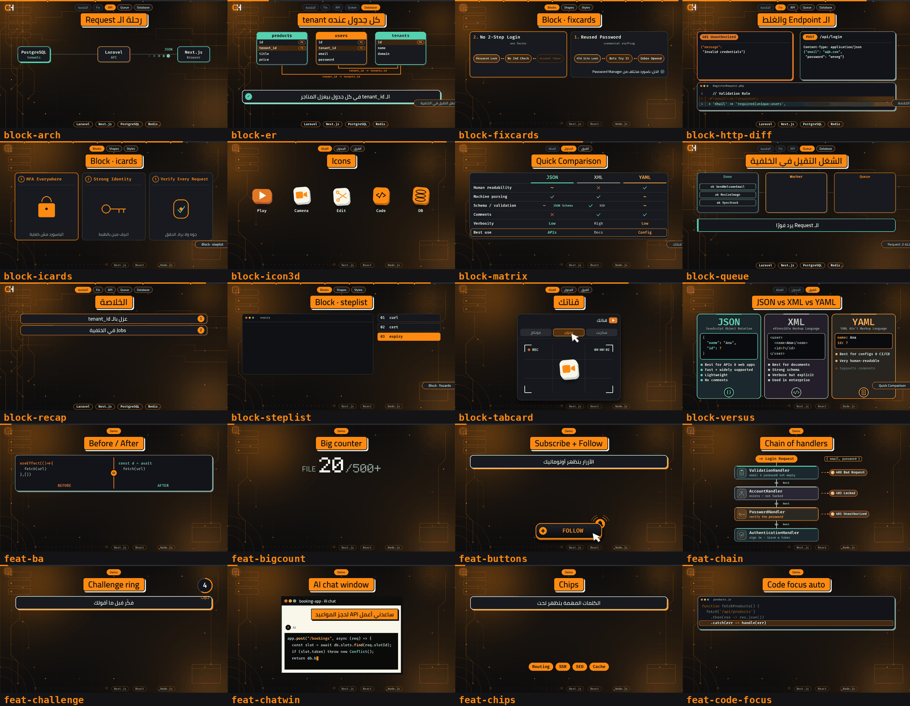
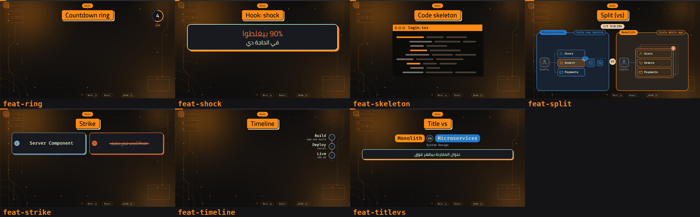
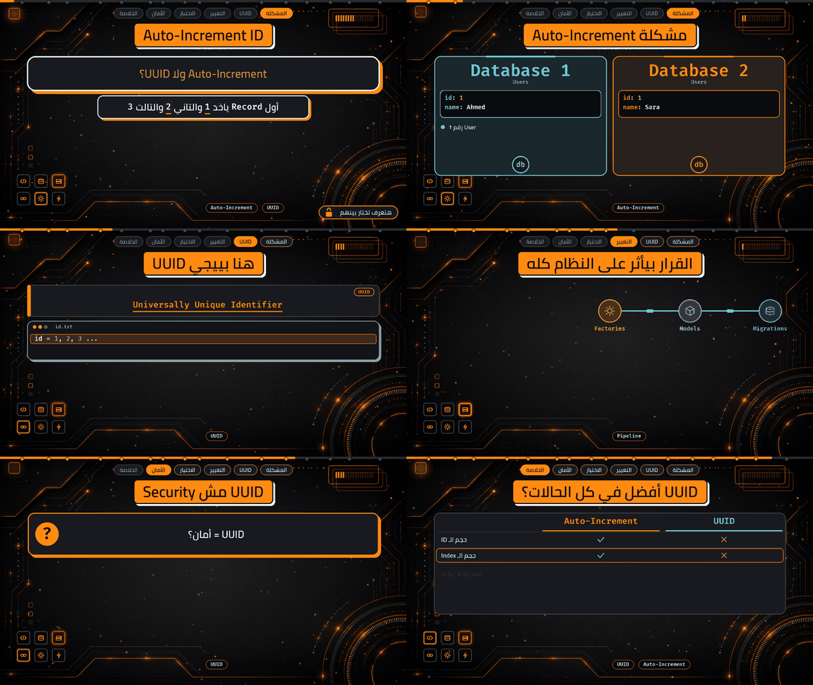

# Features reference (with pictures)

Every feature of the kit, what it looks like, its fields, and where to change it. Pictures are in `docs/images/` and come from the engine itself:
`python3 engine/docs_gallery.py` redraws the `feat-*.png` ones (16:9; set `FMT=reel` for 9:16). Times are seconds of the voiceover.
A block is a dict `{"k": <kind>, "t": <time>, ...}` inside `blocks=[...]` of a scene. Code for block `X` lives in `engine/anim.py`, function `draw_X`.
How to change a look: see `docs/CUSTOMIZE.md`.

## Scene file anatomy
```python
DUR, T_END, TAG1, TAG2 = 166.0, 160.0, 161.5, 163.0   # voice length, end card start, "Think Deeper." time, "Build Smarter." time
STAGES = ["المشكلة", "الحل"]; TECH = ["JavaScript", "Fetch"]   # chapter names, floating tech chips
SUB_T = 58.0; FOL_T = None                                      # button times (False = none)
SC = [dict(style="plain_dark", t0=0, t1=9, stage=0, head="العنوان", head_t=.2, blocks=[ ... ])]
```
Scene keys: `style, t0, t1, stage, head, head_t, blocks, grid, cw, reserve, reserve_reel, longcards`. Scenes must touch: scene N `t1` equals scene N+1 `t0`.

---
## 1. Card styles (scene `style=`)
One name per card. The old short names still work as aliases. Pictures: `cards-dark.png`, `cards-paper.png`.

| # | name | old name | looks like |
|---|---|---|---|
| C01 | `plain_dark` | `classic` | dark card, thin border, accent title |
| C02 | `tag_header` | `proposed` | card with a small coloured tag on top |
| C03 | `glass_blur` | `glass` | translucent glass card |
| C04 | `numbered_list` | `numbers` | big number at the side of each card |
| C05 | `outline_thin` | `outline` | transparent card, thin accent outline |
| C06 | `solid_orange` | `solid` | solid accent fill, black text, hard shadow |
| C07 | `neon_glow` | `neon` | dark card with glowing edge |
| C08 | `paper_note` | `paper` | cream paper note with ink border |
| C09 | `soft_rounded` | `soft` | soft rounded card, no hard border |
| C10 | `terminal_window` | `terminal` | terminal window with a title bar |
| C11 | `step_arrows` | `steps` | numbered steps joined by arrows |
| C12 | `icon_box` | `iconbox` | icon square next to the text |




Use ONE card type for the whole video: `"card_style": "glass_blur"` in the config (or `CTRLH_CARD_STYLES=glass_blur`; several: `plain_dark,neon_glow`; all: `all`).

Allowed styles: config `card_style` / `card_styles` (`"all"` or a list). Style code: `draw_card` in `anim.py`; colours in `themes.py`.

## 2. Card shapes (scene `grid=` / `cw=`)
`squares`, `pairs`, `narrow` (`cw=0.6`), `tiles`. With 2+ cards the engine rotates shapes automatically.


## 3. Basic blocks
**card** `t, text, ok (True/False/None), tag, key, size, words=[(t, word)]`. `words` flashes a word exactly when spoken. Use `NB=" "` (U+00A0) between "الـ" and a Latin word.

**code** `t, file, lines=[(start, text, cps[, (r,g,b)])], focus=[(t,line)] or "auto", shake=t, size`. `file="terminal"` gives the terminal look. Latin text only.
 

**compare** `t, panels=[(title, [(t, text)])]`  
**flow** `t, nodes=[names], steps=[(t, from_idx, to_idx, label)]`  
**timeline** `t, nodes=[(t, label, sub, state)]`  
**counter** `t, t0, t1, v0, v1, label, size` (v1 equals the spoken number)  
**gain** `t, t0, t1, v0, v1, label, unit` (real numbers only)  
Also: `chip` (`t, text`), `title` (`t, text, sub, size`), `zoom` (`t, t_zoom, target, lines, file, magnify`), `phone` (`t, items, title`), `cta` (`t`), `row` (`split, items`), `tiles` (`items, square`).

## 4. Interactive blocks (retention)
| block | fields | picture |
|---|---|---|
| shock (first 3 s hook) | `t, lines=[(text, size, (r,g,b))]` |  |
| strike | `t, t_strike, t_right, wrong, right` |  |
| ba (before / after) | `t, t_slide, before=[..], after=[..]` |  |
| mystery | `t, q, a, t_reveal` |  |
| predict | `t, lines, q, t_count, t_ans, ans` |  |
| poll | `t, q, opts=[(text, 0)], t_fill, win, nopct=True` (never invent percentages) |  |
| note | `t, text` (amber) |  |

**Persistent (`"abs": True`, give the scene `reserve` if they sit at the bottom):**
| block | fields | picture |
|---|---|---|
| promise | `t0, t1, t_unlock, locked, open` |  |
| challenge | `t0, t1, label` |  |
| ring (countdown) | `t0, t1, label` |  |
| chips | `t0, t1, items` |  |
| corner | `t0, t1, labels, switch=[t]` |  |
| button | `kind: subscribe or follow, t0, t1` |  |

Fixed Subscribe / Follow buttons are normally automatic: `SUB_T`, `FOL_T` in the scene file (`False` = none).

## 5. Infographic blocks
`icards` (`t, cols, items=[{t, title, icon, caption}]`, icons shield grid bar clock lock nodes key warn check db bolt) 
`steplist` (`t, list_side, items=[{name, t, file, lines}]`) 
`fixcards` (`t, cols, items=[{t, title, sub, chain, chain_t, fix, fix_t}]`) 

## 6. Comparison blocks
`versus` (`t, h, cols=[{t, name, sub, color, icon, code, bullets}]`; `icon` "doc" or a short symbol; with 3 bullets + 3-4 code lines use `h` >= 660) 
`matrix` (`t, cols, rows=[{t, label, cells}]`) 
`tabcard` (`t, title, tabs=[{t, label, scene}]`) 
`icon3d` (`t, items=[{t, kind, label}]`) 

## 7. Technical blocks (back-end topics)
| block | fields | picture |
|---|---|---|
| arch | `t, nodes=[{t, name, sub, color, state}], reqs=[(t, from, to, label[, 'err'|'back'])]` |  |
| er | `t, tables=[{t, name, color, cols=[(name,'PK'|'FK'|'')]}], links=[(t, from, to, 'fk')]` |  |
| http | `t, method, url, req, t_resp, status, status_text, res` |  |
| diff | `t, file, size, lines=[(t, '-'|'+'|' ', text[, t_gone])]` | same picture |
| queue | `t, worker, queue_name, done_name, jobs=[{name, t_in, t_start, t_done}]` |  |
| recap | `t, title, items=[(t, text)]` |  |

Rule: technical blocks use Latin text only (the mono font has no Arabic). Arabic goes in cards and headlines.

## 8. Flow and system blocks (diagrams from the reference sheets)
Every block works in 16:9 and 9:16 (pictures: `blocks-sheet-1..3.png`). Names, code and tags are Latin (mono font); Arabic is fine in captions, labels and `deviceflow` steps. Demo scene file: `examples/v9_flow_scenes.py`.

| block | use for | fields | picture |
|---|---|---|---|
| titlevs | header of a comparison: two coloured pills, round "vs", sub line | `t, a, b, ca, cb ("#RRGGBB"), sub` |  |
| split | two systems side by side (16:9) or stacked (9:16) with a VS badge: scaling, deploy, calls | `t, counter:"1/5 SCALING", panels:[{name, tag, color, src:{name,icon}, mode:"box" or "fan", services:[{t,name,icon}], events:[(t,'traffic',idx),(t,'fail',idx),(t,'scale',idx),(t,'ver',idx,'v2')]}]` (`idx -1` = the whole box in mode box) |  |
| chain | chain of responsibility / middleware: handlers in a column with "Next" links and red error exits | `t, start, payload, link, steps:[{t,name,sub,icon,color,err:(t,'400 Bad Request')}]` |  |
| hub | controller / service with spokes: which action touches which service (packets in the action colour) | `t, top, user, hub:{t,name,sub,icon,color}, actions:[{t,name,icon,color,to:[spoke idx]}], spokes:[{t,name,icon,color}], numbered, q, q_t` |  |
| pipeline | steps joined by chain links, with NEW / v2 badges | `t, nodes:[{t,name,icon,color,badge:(t,'NEW','#hex')}]` |  |
| deviceflow | phone + API + checklist: a request passes several checks | `t, phone:{title,fields:[(icon,text)],button,press_t}, api:{t,name,sub,color}, steps:[{t,tag,label,icon,color}]` |  |
| codeann | annotated code: squiggles, tags, counter, pressure bar, caption | `t, file, lang, lines:[(t,text)], squiggle:[(t,line)], tags:[(t,line,text,'#hex')], counter:(t,text), bar:(t0,t1,'#hex'), label:(t,text,'#hex'), cap:(t,text)` (about 12 lines max) |  |
| flowmini | small flow: Command -> Message -> Handler | `t, items:[{t, kind:'pill'/'card'/'circle', name, icon, color}]` |  |

9:16 pictures:   

Icons for these blocks (`icon`): user cart card code search gauge link clip server mail gear cube bell truck key lock shield db check x clock doc bolt. Add one in `_ico` of `engine/blocks_flow.py`.

## 9. Automatic features (no code in the scene file)
chapter banner "الجزء N من M · name" (`STAGES`), scene-progress dots, next-scene preview pill, scene link frame, camera push-in, alternating entry directions, floating monogram, SFX per block (`engine/make_audio.py`), end card with logo and sign-off, Subscribe / Follow buttons, safe area and design tokens (`engine/tokens.py`), auto focus for code, LINT on every render.
`dims` (screen darkening) exists but is OFF: it looked like the screen turning off. `CTRLH_DIMS=1` or config `"dims": true` turns it on.

## 10. Themes and backgrounds
 
Config: `theme`, `bg_style`, `card_styles`, `signoff_1`, `signoff_2`.

**Three themes** (the skill asks which one before each video): main dark `orange` (`hud_live`), `paper_orange` and `soft_cream` (v2.1.0: white rounded cards, light shadow, cream background with orange glow, dark H logo, soft Subscribe/Follow buttons and end card, chapter pill merged at the bottom-right). A theme's own `bg` replaces `hud_live` unless `"bg_style_locked": true`. Backgrounds are chosen separately (`bg_style`, picture `backgrounds.png`).

Per-series theme: `"series": "name"` in the config (with `series_name`) overrides theme/accent for that series.

`hud_live` chips: per scene from `chips`, then tools found in the text, then `TECH`; each has an icon (`HUD_ICONS`).

## 11. Tools
| command | job |
|---|---|
| `python3 engine/build.py <scenes> --vo voice.wav` | lint, contact sheet, split plan, render (cache), SFX, mux, meta, all in one |
| `python3 engine/lint.py <scenes> [--strict] [--sheet out.png]` | check a scene file without rendering |
| `python3 engine/render.py <scenes> out.mp4` | render one video (env `FMT`, `CTRLH_T0/T1`) |
| `python3 engine/meta.py <scenes> out.md` | chapters, description, hashtags |
| `python3 engine/docs_gallery.py` | redraw the feature pictures |
| `python3 engine/align.py <scenes> voice.wav` | align scene times to the audio (silence + weights; `--whisper` optional) |
| `python3 engine/suggest.py <script.txt>` | suggest scenes/blocks from a script |
| `python3 engine/preview.py <scenes>` | fast low-res preview |
| `python3 engine/srt.py <scenes> out.srt` | subtitles |
| `meta.py` also writes `<name>_chapters.txt` | YouTube chapters |
| scenes as `.py` or `.json` | `engine/scenefile.py`; Node helper `node/ctrlh.js` (see `node/example.js`) |

Lint now also checks: waw between Latin words, missing NB after `الـ`, empty/static scenes, overlong cards.

## 12. Paper theme + paper blocks (optional)

Light "paper" look: cream background, dot grid, ink text, yellow highlighter.
Enable: `"theme": "paper_orange"` in the config, or `CTRLH_THEME=paper_orange`.
The six paper blocks work on every theme (dark too); the flow blocks and legacy blocks are patched to stay readable on the light theme.


| Block | Fields | Use it for |
|---|---|---|
| `quote` | `t, who, lines, hl=[(word,t)]` | quote card with highlighter on key words |
| `chatwin` | `t, title, ask, ask_t, who, lines=[(t,code)], cursor` | AI chat / coding-agent demo |
| `minichart` | `rows=[{t,label,kind:down/up,values}]` | cost down / growth up |
| `skeleton` | `file, n, span, seed, hl` | code-shape skeleton ("so much code") |
| `filegrid` | `files, cols, span, missing=(idx,t), pick=(idx,t)` | project scale, missing file, pick one |
| `bigcount` | `label, t0, t1, v0, v1, suffix, cell` | pixel-font big counter |

Images: `images/blocks-sheet-1..3.png`.
Code: `engine/blocks_paper.py`; theme entry in `engine/themes.py`; background `paper` in `engine/bg_styles.py`.

### Ready background image: `assets/backgrounds/hud_dark.png`
Sharpened 1920x1080 version of the HUD circuit background (the small chips Docker / Compose / Linux are part of the picture). Use it with `"background_file": "assets/backgrounds/hud_dark.png"` in the config (16:9 only), or per render: `CTRLH_BG_STYLE=minimal BGFILE=assets/backgrounds/hud_dark.png`.

### Live HUD background: `bg_style: "hud_live"` (default)

Animated version of the HUD circuit background (16:9 only): current pulses run along the orange traces, particles drift, icons light up in the 3x2 squares (bottom-left), a loading bar fills (top-right).
**Chips (bottom) change with the topic.** For every scene the engine shows the tools that scene talks about:
1. scene key `chips=["Laravel", "Sanctum"]` (max 3) wins; use it whenever you want exact names;
2. otherwise the tools found in the scene text (list `HUD_TOOLS` in `engine/blocks_hud.py`, first mention first);
3. otherwise the video-wide `TECH` list.
Chips cross-fade when they change between scenes. Static alternatives: `"bg_style": "circuit"` or `"background_file": "assets/backgrounds/hud_dark.png"` (chips baked in, not recommended).
Plate image: `assets/backgrounds/hud_plate.png` (override with `CTRLH_HUD_PLATE`). Size and render time are the same as the static background.

## 13. Sound library, captions and 9:16 (v2.1.0)
- **Sounds:** 34 named sounds in `assets/sfx/` placed automatically at 30% under the voice, or pinned with `SFX = [(t, "name")]`: [SOUNDS.md](SOUNDS.md).
- **Captions (optional):** `engine/captions.py cues.txt in.mp4 out.mp4`: Arabic in a box, orange highlight on `[[key words]]` and on every English word.
- **Formats:** 16:9 and 9:16 are both native renders of the same scene file (not a crop).
- **How-to template:** `examples/template_howto_scenes.py`, 58 s 16:9, `# EDIT` lines.
- **Tech backgrounds:** `bg_style: "tech:laravel"` (nextjs, react, laravel, wp, docker, node, rest, db, redis, git; 16:9).
- **Soft chat window:** the `chatwin` and other paper blocks follow `soft_cream` (light shadow, thin border, cream title bar).
- **Checks without rendering:** `check_voice.py`, `sfx_preview.py` (hear voice + SFX), `smoke.py` (whole-kit test).
- **Captions from voice + script:** `asr_captions.py` then `captions.py`.
- **Reel clips from a long video:** `reels.py`.
- **Typing rhythm:** `TYPING_SPEED` in the scene file.
